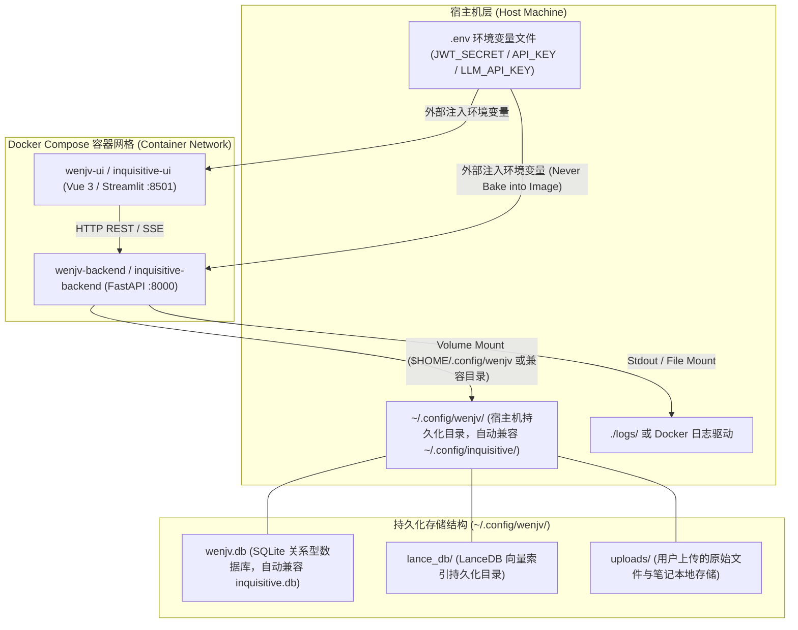

# 部署与数据目录拓扑 (Deployment & Data Directory Topology)

本文档阐述 wenjv（问据）知识库的容器部署架构、宿主机数据持久化目录映射、向后兼容机制，以及敏感密钥的安全治理边界。

## 1. 容器部署拓扑图 (Docker Compose Topology)

## 2. 数据目录说明 (`~/.config/wenjv/`)

wenjv（问据）默认采用轻量级的自托管嵌入式存储引擎，无需额外启动庞大的独立数据库容器（如 PostgreSQL / Elasticsearch / Milvus），所有核心持久化数据集中管理于标准配置目录 `~/.config/wenjv/` 中（若存在历史 `~/.config/inquisitive/` 目录则自动兼容回退）：

> [!TIP]
> **容器权限与路径映射建议 (Container Permissions & Mounts)**: 生产级容器安全最佳实践通常建议使用非 root 专用运行账户（如 `appuser`，uid=1000）。在编排 Volume 挂载时，建议将容器侧目标路径声明为通用的 `$HOME/.config/wenjv`（或对应专用账户的宿主目录如 `/home/appuser/.config/wenjv`，并自动回退到兼容路径 `~/.config/inquisitive`），并在挂载前确保宿主机挂载目录具有匹配的读写权限，避免硬编码 `/root/` 产生权限映射出入。

| 目录/文件 | 描述 | 备份/迁移建议 |
| :--- | :--- | :--- |
| `wenjv.db` (或兼容 `inquisitive.db`) | SQLite 关系数据库，存储用户信息、笔记/文件元数据、Durable 异步作业队列以及 SQLite FTS5 倒排索引库。 | **优先备份**。体积小，直接复制文件或通过 SQLite 备份 API 进行一致性快照。 |
| `lance_db/` | LanceDB 向量存储库，保存所有切块的 384维/1536维 稠密向量数据与快速过滤倒排索引。 | **同机目录备份**。支持与关系数据库同步快照迁移，解压即用。 |
| `uploads/` | 用户通过网页或 API 上传的 Markdown 笔记、PDF 文档等原始文件实体。 | **静态资源同步**。使用 `rsync` 或通用增量同步工具持久化。 |
| `logs/` | 后端服务运行日志、异步作业执行堆栈与报错记录。 | 可设置定期滚动清理，不影响业务元数据完整性。 |

---

## 3. 密钥安全治理声明 (Secrets Security Governance)

> [!WARNING]
> **严禁将敏感凭据打包入镜像 (Secrets Do Not Enter Images)**: 
> 为遵循零信任安全原则与容器实践规范，所有涉及鉴权与外部调用等敏感凭据（Secrets），在任何情况下均**禁止**硬编码进代码库或写入 Dockerfile / 镜像底层构建层中！

所有安全参数必须且仅通过宿主机的 `.env` 环境变量文件或容器编排的 `environment` 动态注入：

- **`JWT_SECRET`**: 用于对 API 鉴权 Token 进行 HMAC-SHA256 签名的核心密钥。生产环境必须采用高熵随机字符串（建议 `openssl rand -hex 32` 生成），禁止使用默认值。
- **`API_KEY` / `SILICONFLOW_API_KEY` / `OPENAI_API_KEY`**: 外部模型 API 调用的访问凭据，通过运行态环境变量懒加载注入。
- **租户安全边界**: API Router 与底层 Vector/SQLite 查询均依赖通过 Token 解析出的合法 `user_id`，在物理及逻辑层面彻底阻止跨租户越权读写（Tenancy Isolation）。
