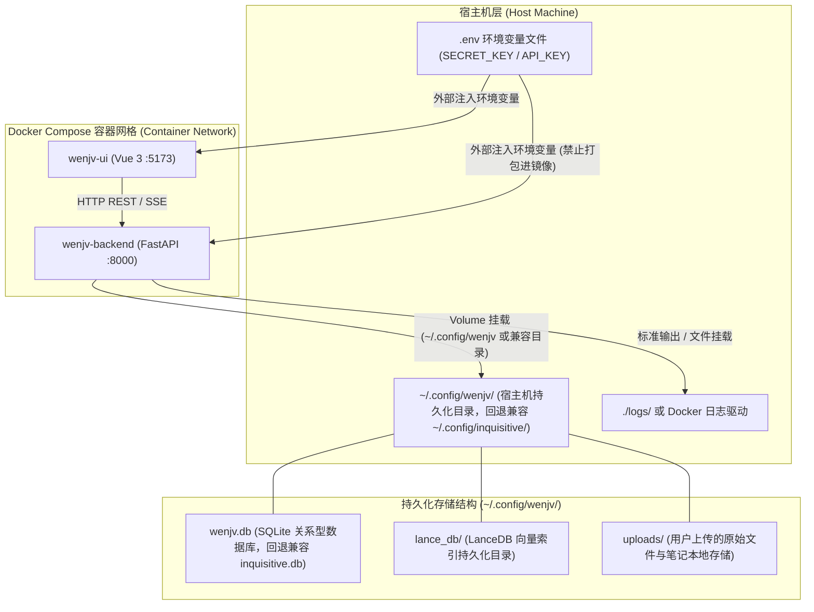

# 部署与数据目录拓扑 (Deployment & Data Directory Topology)

本文档阐述 wenjv（问据）知识库的容器部署架构、宿主机数据持久化目录映射、向后兼容机制，以及敏感密钥的安全治理边界。

## 1. 容器部署拓扑图 (Docker Compose Topology)

## 2. 数据目录结构 (`~/.config/wenjv/`)

wenjv（问据）采用嵌入式存储引擎，无需启动独立的外部数据库服务，持久化数据集中管理于标准配置目录 `~/.config/wenjv/` 中（若存在历史 `~/.config/inquisitive/` 目录且新目录为空时，系统会自动回退读取）：

> [!TIP]
> **容器权限与路径映射**: 容器化运行时推荐使用非 root 专用运行账户（如 `appuser`，uid=1000）。在编排 Volume 挂载时，建议将容器侧目标路径声明为专用账户的主目录（如 `/home/appuser/.config/wenjv`），并在宿主机预先确认目录读写权限，避免因用户 ID 不匹配引发权限异常。

| 目录与文件 | 职责定位 | 备份与运维建议 |
| :--- | :--- | :--- |
| `wenjv.db` (或兼容 `inquisitive.db`) | SQLite 关系型数据库，维护用户凭据、笔记/文件元数据、持久化任务队列状态机以及 FTS5 倒排索引表。 | **核心备份文件**。可通过直接复制冷备或利用 SQLite 备份接口创建快照。 |
| `lance_db/` | LanceDB 向量存储目录，保存切块的 384 维（本地 all-minilm）或 1024 维（云端 bge-m3）稠密向量索引。 | **与关系数据库同步备份**。支持同机快照打包迁移。 |
| `uploads/` | 用户上传的 Markdown 笔记、PDF 文档等原始文件。 | **静态文件备份**。可通过 `rsync` 等工具进行增量同步。 |
| `logs/` | 后端服务日志、异步任务执行堆栈与报错记录。 | 可配置定期滚动清理，不影响业务元数据完整性。 |

---

## 3. 密钥安全治理规范

> [!WARNING]
> **严禁将敏感凭据打包入镜像**:
> 所有涉及鉴权与外部接口调用的敏感凭据，严禁硬编码进代码库或写入 Dockerfile 构建层中。

所有敏感参数必须通过宿主机的环境配置文件或容器运行参数动态注入：

- **`SECRET_KEY`**: 用于对 JWT 访问凭证进行 HMAC-SHA256 签名的核心密钥。生产环境必须采用高熵随机字符串（例如使用 `openssl rand -hex 32` 生成），禁止使用默认占位值。
- **`EMBEDDING_API_KEY` / `CHAT_API_KEY`**: 外部云端模型服务的调用凭据，运行时通过环境变量按需加载。
- **租户安全边界**: API 呈现层与底层查询逻辑均强制依赖 Token 解析出的 `user_id`，在应用和数据访问层实现严格的行级租户逻辑隔离 (Row-Level Tenancy Logical Isolation)。
