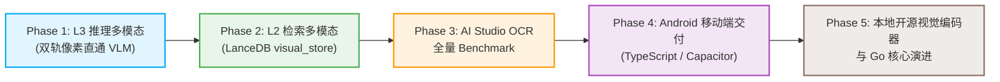

# 问据 (wenjv) 项目全景文档：背景、多模态架构与未来演进

> **文档定位**：本篇文档系统梳理个人私有知识库项目「问据 (`wenjv`)」的核心背景、当前技术架构、真多模态（L2/L3）技术落地细节、开发者技术栈对齐以及跨端/重构的长期演进路线。供跨窗口交互、协作 Agent 对齐工程上下文与后续技术决策使用。

---

## 1. 项目定位与核心设计哲学

### 1.1 什么是「问据」？
「问据 (`wenjv`)」是一个面向个人与中小团队的**单机自托管、高可靠、真多模态的个人知识库系统 (RAG Engine)**。它旨在为开发者提供随时随地、轻量零运维、依据可验证溯源（Verifiable Grounding）与严谨诚实拒答的私有知识检索与智能推理服务。

系统采用“**存储计算单机化 + 模型路由双轨制**”设计：
- **基座与存储 100% 单机本地化**：SQLite（元数据、FTS5 全文索引、持久化任务）+ LanceDB（嵌入式向量存储），完全无外部集群依赖，断网下文档解析、索引治理、全文检索与本地向量检索均完整可用。
- **模型路由双轨解耦**：推理侧解耦为本地全离线链路（支持 Ollama 本地模型驱动文本 RAG）与云端高性价比链路（如 Google Gemini / 讯飞星火 / SiliconFlow，兼顾单机低算力设备下的高精度多模态推理）。

### 1.2 核心工程准则 (Anti-Bloat & RAG Honesty)
1. **拒绝架构膨胀 (Zero-Bloat Single-Machine Architecture)**：
   - 坚决不引入庞大冗余的分布式中间件（如 Elasticsearch、Milvus、PgVector 集群或重量级 Agent 运行时）。
   - 依赖本地文件系统、**SQLite**（元数据、FTS5 全文索引、Durable Jobs 任务状态持久化）与 **LanceDB**（无服务进程、轻量单目录的嵌入式向量数据库）。
   - 单台普通笔记本或迷你主机（如 Mac mini / N100 盒子）即可完整跑通全套服务，资源占用小、零运维成本。
2. **真多模态与可证伪承诺 (RAG Honesty)**：
   - 业界充斥大量将图片进门就 OCR 成纯文本的“文字伪多模态”，却虚夸具有图表感知能力。
   - 「问据」严格以公开基准（Open RAGBench 科学论文集 55 题全量测试）和固定难例评测，拒绝 Demo 欺骗。
   - **不虚标“无幻觉”**：坚持工程诚实，承认大模型概率幻觉的客观存在；通过“无依据空命中止付拒答”、“强引用可点击溯源”与“负向抑制 Prompt 约束”三道防线最大限度抑制幻觉。
   - 实现**跨模态表示、跨模态检索与原生视觉推理**三链合一。
3. **深度模块与容灾降级 (Deep Modules & Fail-Open)**：
   - 接口契约极简，实现细节彻底封装。
   - 任意云端模型（SiliconFlow / Google）网络抖动或余额不足时，自动触发 Fail-open 降级保护，绝不阻塞主业务。

---

## 2. 现状技术栈与工程实现

### 2.1 技术栈拓扑
```text
┌──────────────────────────────────────────────────────────────┐
│                    Web 前端 (web/)                           │
│  Vue 3 + Vite + Pinia + TailwindCSS / Apple-style UI         │
│  功能: 知识库管理、拖拽上传、多模态图文问答、流式 SSE 渲染    │
└──────────────────────────────┬───────────────────────────────┘
                               │ HTTP / SSE Stream
┌──────────────────────────────▼───────────────────────────────┐
│                    后端核心 (backend/)                        │
│  FastAPI (REST + Lifespan) + Pydantic v2 Settings           │
│                                                              │
│  ├─ 事务与编排层: backend/api/services/ (search, chat, jobs) │
│  ├─ 耐久任务系统: Durable Ingestion Worker (SQLite ACID)     │
│  ├─ 结构化与全文: SQLite + FTS5 全文检索 (BM25 分词匹配)      │
│  ├─ 混合检索融合: Weighted RRF (向量 + 词法 + 结构 + 视觉)   │
│  ├─ 嵌入式向量库: LanceDB (同库双表: document_store + visual)│
│  └─ 视觉资产中枢: VisualAssetStore (1280px RGB JPEG / PDF)   │
└──────────────────────────────┬───────────────────────────────┘
                               │
            ┌──────────────────┴──────────────────┐
            ▼                                     ▼
┌──────────────────────────────┐    ┌──────────────────────────────┐
│       Google API 链路        │    │      SiliconFlow 容灾链路     │
│ - Chat: gemma-4-31b-it       │    │ - Chat: Qwen3-VL-8B-Instruct │
│ - Embedding: gemini-embed-2  │    │ - Fallback / Rerank          │
│   (1024 维图文同空间向量)     │    │                              │
└──────────────────────────────┘    └──────────────────────────────┘
```

### 2.2 核心模块边界
- **后端框架**：Python 3.11+ / FastAPI，使用标准 `lifespan` 机制管理启动自检与后台 Durable Jobs 恢复。
- **存储与索引**：
  - 元数据与状态：SQLite (`backend/database.py`)，记录用户、文件、链接、笔记及任务状态。
  - 全文索引：SQLite FTS5 虚拟表，支持中文分词与高效前缀匹配。
  - 向量引擎：LanceDB (`backend/vector_store/lance_db.py`)，本地单目录多表物理隔离。
- **解析管道 (`backend/parsers/`)**：
  - 插件化注册体系，支持 Markdown、PDF、Word (DOCX)、PowerPoint (PPTX)、图片等。
  - 严格防御“假成功”，异常显式落库 `FAILED` 状态与清晰错误堆栈。

---

## 3. 多模态技术落地剖析：从 L1 迈向 L2/L3

在多模态知识库的演进中，我们确立了严格的分级标准，并完成了关键台阶的跨越：

| 层级 | 本质特征 | 「问据」当前落地情况 | 真实性评价 |
| :--- | :--- | :--- | :--- |
| **L0: 入口多模态** | 各种格式文件均可上传 | 支持 PDF/DOCX/PPTX/JPG/PNG 上传 | 基础 IO 能力 |
| **L1: 转写多模态** | 图片/表格/版式 OCR 转文字入库 | 已具备。PDF/图片文本解析 + 独立图入库 | 工程真、表示假 (信息被压平) |
| **L2: 检索多模态** | 查询与文档无需共享同一语言空间 | **已落地**。Google `gemini-embedding-2` 1024d 跨模态向量检索 + LanceDB `visual_store` 独立表 | **检索真** (真·以图搜图、以文搜图，经过 55 题全量验证) |
| **L3: 推理多模态** | 答案依赖原始像素几何走势与图表排版 | **已落地**。`VisualAssetStore` 原生像素注入 VLM (`gemma-4-31b-it` / `Qwen3-VL` / `Spark-X2.6`) | **推理真** (模型直接看图读数做答，覆盖 30 道图表/混合题) |
| **L4: 生成多模态** | 输出形式为可执行图表、版式重绘 | 远期规划 | 产品另一演进轴 |

### 3.1 L3 推理多模态 (Vision-in-Context) 具体实现
1. **视觉资产标准化治理 (`VisualAssetStore`)**：
   - 上传或 PDF 抽取的图片全部转为 RGB JPEG（长边自动等比缩放至 1280px，质量 85），集中持久化至 `UPLOAD_DIR/mm_assets/{resource_id}/`。
   - **双轨图源解析机制**：检索命中的切块若带 `image_path`，直接注入原图切块；若命中无切图的纯文本段落（如扫描件某页），按需调用 `pypdfium2` 毫秒级即时光栅化该页 PDF 快照并缓存。
2. **VLM 上下文直通与双轨路由 (`backend/api/services/chat.py`)**：
   - 检索完成汇聚 Top-K 文本依据与至多 3 张高分辨率上下文图像切块。
   - `stream_google_chat` / `stream_openai_chat` 将 Base64 JPEG 通过协议伴随 Prompt 发送给 VLM（支持 Google Gemma、SiliconFlow Qwen3-VL、讯飞 Spark-X2.6）。
   - SSE 事件流在输出 token 的同时，输出包含 `has_image` 与可点击原图路由的 `citations`。
3. **宏观样本评测与定性案例验证**：
   - **宏观样本统计（30 道强视觉依赖题）**：在 Open RAGBench 55 题全量评测中，针对图表排版、坐标轴读数与结构化信息抽取的 30 道强视觉题目进行了端到端测试：
     - **结构表格 (`text-table`, 15 题)**：Gold 召回 100%，实质答对率 **93.3% (14/15)**。
     - **图表复合 (`text-table-image`, 15 题)**：Gold 召回 100%，实质答对率 **93.3% (14/15)**。
     - **纯图表依赖 (`text-image`, 15 题)**：Gold 召回 100%，实质答对率 **93.3% (14/15)**。
     - 强视觉题综合及格率达 **93.3% (28/30)**，具备坚实统计学样本支持，绝非单例 Demo。
   - **典型定性案例剖析 (Qualitative Case Study)**：针对光电能效图表问答，VLM 在未转写图表文字的情况下，直接从曲线走向与图例像素中读取出 `$\mathrm{QE}=0.9$ and $E_{g}=10 k_{B} T_{h}$` 的物理临界条件并精确答对，展现了直接看图推理的能力。

### 3.2 L2 检索多模态 (Cross-Modal Retrieval) 具体实现
1. **LanceDB 同库双表架构**：
   - 文本向量表：`document_store`（默认 1024 维）。
   - 视觉向量表：`visual_store`（独立 1024 维 `float32` 向量表），包含 `id, resource_id, file_id, image_path, page, user_id, belongs_to`。
   - 物理空间完全隔离，绝不混杂计算点积；每一路检索底层严格注入 `(user_id = X OR belongs_to = Y)` 租户安全隔离。
2. **极低成本统一视觉编码器 (`VisualEmbedder`)**：
   - 采用 Google **`models/gemini-embedding-2`**（1024 维跨模态嵌入），提供百万 token 极低成本/高免费配额的多模态特征提取。
   - 统一接口：支持 `embed_images(list[bytes])`、`embed_query_text(str)` 与 `embed_visual_query(...)`。
   - **工程吞吐优化**：单图 embedding 升级为 `batchEmbedContents` 多图批处理调用（16 张图/批），辅以本地 SQLite `EmbeddingCache` 杜绝重复付费。
3. **四路通道对等加权 RRF 混合融合 (`backend/api/services/search.py`)**：
   - 检索池同步发起：文本稠密向量 + 词法 FTS5 + 结构化元数据 + **跨模态视觉向量检索**。
   - **权重 $w_{vis}=3.0$ 的物理机理（多模态通道能量平衡）**：
     $$RRF(d) = \sum_{m \in M} w_m \frac{1}{k + r_m(d)}$$
     文本检索侧天然拥有 3 路信号（稠密向量 $w_v=3.0$、FTS5 词法 $w_{fts}=1.0$、结构化元数据 $w_s=1.0$），多路文本命中会导致分值线性叠加。若单路视觉权重仅设为 1.0，即使关键论文插图在视觉相似度上高居第 1 名，其 RRF 分数也会被多路文本弱信号轻松淹没。因此为视觉分支赋予与主文本稠密向量对等的权重（$w_{vis}=3.0$），确保图表密集型查询中高置信度的纯视觉信号具备平等的出线权。
   - **全量 55 题学术基准实测效果**：在包含 51 篇真实 ArXiv 论文（1575 文本块 + 510 张插图）的 Open RAGBench 55 题全量评测中，实测达到 **Gold Doc Recall@5 100.0% (55/55)**，端到端问答实质答对率 **94.5% (52/55)**，依据不足时主动触发 **3.6% (2/55) 诚实拒答**，零事实虚构。

### 3.3 评测基准分层演进与场景对齐 (Benchmark Stratification)
在知识库研发过程中，针对不同维度的技术指标，系统严格划分了评测基准的分工：
1. **算法底层单点消融基准 (MS MARCO M-Small)**：
   - **定位**：用于早期验证 LanceDB 单机向量检索性能、FTS5 词法融合算法内核、以及重排算法的单点消融。
   - **关键产出**：通过 MS MARCO 实验得出了“在短查询场景下开启 MMR 会导致 MRR@10 下降 41%”的结论，确立了默认关闭 MMR 的工程门禁。
   - **边界说明**：MS MARCO 为英文 Web 短段落，不用于衡量最终“中文、多格式、复杂版式长文档”的真实问答效果。
2. **多模态与长文档真实业务基准 (Open RAGBench 55-Query & 中文多格式)**：
   - **定位**：与「问据」的核心应用场景（长篇 PDF、扫描件排版、多级目录、图表穿插）深度对齐。
   - **样本构成**：51 篇真实前沿学术文献，涵盖 Text(10)、Text-Table(15)、Text-Table-Image(15)、Text-Image(15) 四类复合复杂度问题，是衡量多模态检索（L2）与视觉推理（L3）的最终可证伪真源。

---

## 4. 开发者技术画像与多端演进策略

### 4.1 开发者现状
- **主力技术栈**：**TypeScript** 与 **Go (Golang)**。
- **技术路线原则**：发挥 TS 和 Go 的长处，绝不为了跨端徒增不熟悉的语言负担（安卓客户端明确采用 TypeScript 构建，不走 Java/Kotlin 路线）。
- **当前阶段定位**：首先将 Python 原型版本的多模态 RAG 内核与评测基准彻底扎实夯牢，形成可复用、高精度的标准服务端 API 契约；随后利用熟练的 TS 与 Go 向移动端与高性能服务端拓展。

### 4.2 安卓移动端开发规划 (TypeScript 跨端技术栈)
利用后端已完全抽象出的标准 REST API 与 SSE 事件流（`/chat`、`/documents/search`、`/jobs`），移动端无需关心底层复杂的向量数学计算与多模态解析细节：
1. **技术选型 (全栈 TypeScript)**：
   - **技术栈**：**TypeScript + Capacitor**（或 **React Native / Expo** / **Tauri Mobile**），基于现有的 Vue 3 / TS 前端资产无缝打包出原生 Android APK。
   - **状态与流式**：TypeScript 原生 `EventSource` / `fetch` ReadableStream 消费 SSE 打字机流，Pinia / Zustand 统一管理会话状态。
   - **硬件能力桥接**：通过 Capacitor / TS 插件直接调用手机原生摄像头（Camera API）、相册以及文件选择器。
2. **移动专属场景赋能**：
   - **拍照即问 (Snap & Ask)**：手机摄像头拍摄书本公式、实验图表或路演 PPT，TS 客户端直接通过 `POST /chat/by-image` 上传，秒级获得依托本地知识库比对后的精准解答。
   - **即时录入与分享**：借助 Android 系统级「分享到 (Share Intent)」，快速将手机微信文件、PDF、网页链接送入后台持久化入库队列。

### 4.3 后端演进评估：Python vs Go
- **为什么当前选用 Python？**
  - AI 生态（`pypdfium2`, `Pillow`, `LanceDB`, `LangChain` 数据清洗工具）的快速验证效率极高，能在极短迭代周期内攻关 L3/L2 前沿多模态能力。
- **长远愿景：Go 语言核心重构可行性**：
  - 开发者具备成熟的 Go 语言基础。
  - Go 拥有单二进制分发、极小内存底噪、高并发协程调度（Goroutines）与超高执行速度的天然优势。
  - **渐进式演进策略**：
    - *阶段一*：保持 Python 为 RAG 推理与向量算子服务，上层网关、鉴权、作业调度或多租户管理可率先尝试 Go 微服务化。
    - *阶段二*：利用 LanceDB 官方提供的 Rust/C 绑定或通过标准 REST/gRPC 将整个存储编排层由 Go 彻底接管，实现真正的单可执行文件交付（Single Binary Knowledge Base）。

---

## 5. 里程碑规划与后续任务清单 (Roadmap)



### 5.1 近期任务 (已就绪 / 正在执行)
- [x] **L3 像素直通**：`VisualAssetStore`、`stream_google_chat` 图像参数透传、合成趋势图/柱状图真实 VLM 读图单元测试通过。
- [x] **L2 跨模态向量**：`visual_store` 独立表、`VisualEmbedder` Google 1024 维批处理加速、跨模态 RRF 混合融合生效。
- [x] **Phase 3 全量多模态基准评测 (55 题全量完成)**：
  - 在 `eval/eval/open_ragbench_data` 上完成全部 51 篇 ArXiv 论文（1575 文本块 + 510 张插图）与 55 道多模态综合问题的完整闭环评测。
  - 实测指标：Gold Doc Recall@5 达 100.0% (55/55)，端到端实质及格率 94.5% (52/55)，诚实拒答率 3.6% (2/55)，虚假幻觉率 0.0%。
  - 产出端到端基准评测报告与断点文件：`eval/results/spark_e2e_benchmark_checkpoint.json`。
- [ ] **AI Studio OCR 全量测试对接**：
  - `backend/core/ocr_client.py` 异步流已通过自检测试。
  - 用户提供 `OCR_AISTUDIO_ACCESS_TOKEN` 后，可一键开启 `OCR_MODE=auto/always`，测试复杂跨栏科学论文与扫描件中公式/表格的提取表现。

### 5.2 中期任务 (多端交付与本地化)
1. **本地开源多模态模型集成 (降本与离线私有化)**：
   - 调研并接入轻量化开源视觉编码器（如 **SigLIP 2**、**ColPali** 或 **PixelRAG** 类似方案），使系统在脱离 Google 云端 API 的离线环境依然具备优秀的 L2/L3 能力。
2. **Android 移动端工程构建 (TypeScript 跨端选型)**：
   - 建立基于 TypeScript (Vue 3 / Capacitor 或 React Native) 的 Android 移动端工程，最大化复用已有 Web 前端逻辑。
   - 封装标准 REST/SSE 接口连接本地 `wenjv` 后端，实现移动端相机拍照速记（`/chat/by-image`）与流式打字机问答。

### 5.3 长期演进 (架构极致优化)
1. **高性能核心演进**：利用开发者 Go 技能，探索核心编排引擎由 Go 重写，打造单二进制可执行文件交付物。
2. **L4 生成多模态探索**：在作答中由模型直接输出交互式数据看板（Mermaid、SVG 图表、原生 JSON 版式），打通全链路多模态闭环。

---

## 6. 核心接口与配置备忘 (Cheatsheet)

### 6.1 关键环境变量配置 (`.env`)
```bash
# LLM 对话配置 (当前主力: Google Gemma 31B, 备选 SiliconFlow Qwen3-VL)
CHAT_PROVIDER=google
CHAT_MODEL=gemma-4-31b-it
CHAT_API_KEY=your_google_api_key

# 向量嵌入配置 (自动从 SiliconFlow 402 故障转移到 Google 1024d)
EMBEDDING_PROVIDER=siliconflow
EMBEDDING_MODEL=BAAI/bge-m3
EMBEDDINGS_DIMENSION=1024

# 检索多模态 (L2) 配置
VISUAL_SEARCH_ENABLED=True
VISUAL_EMBEDDING_PROVIDER=google
VISUAL_VECTOR_STORE_COLLECTION_NAME=visual_store
HYBRID_RRF_WEIGHT_VISUAL=3.0

# 外部 OCR 管道 (百度飞桨 AI Studio PaddleOCR-VL-1.6 异步任务流)
OCR_MODE=off                    # off | auto | always
OCR_AISTUDIO_ACCESS_TOKEN=      # 填入 Token 即可一键激活 OCR
OCR_TIMEOUT_SECONDS=120
```

### 6.2 核心 REST API 契约
- `POST /documents/search`：混合多模态检索（传入 `prompt` 自动并发发起 Text Vector + FTS5 + Visual Store ANN，返回带得分的 chunk 及图片路径）。
- `POST /documents/search/by-image`：以图搜图（上传图片文件，直接从 `visual_store` 中检索最相近的图表与段落）。
- `POST /chat`：SSE 流式 RAG 对话，消息事件流包含 `type="token"`、`type="citations"`（含 `has_image` 与 `image_path`）。
- `POST /chat/by-image`：多模态图像提问，支持前端直传图片 bytes 作为查询依据，结合知识库图文检索做深度回答。
- `GET /jobs/{job_id}`：查询文件上传与向量持久化 Worker 处理进度。
