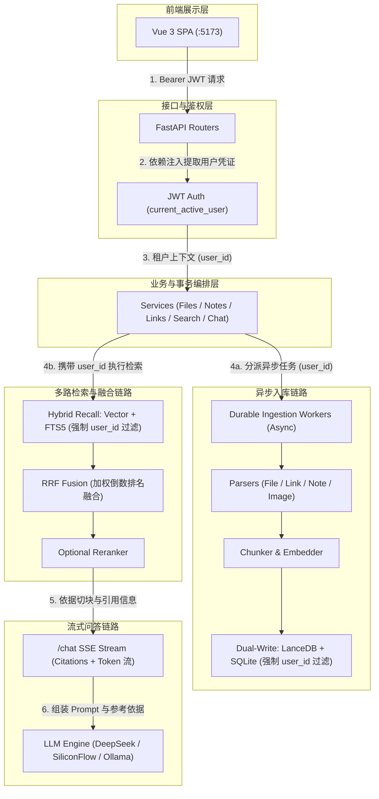

# 架构规范 (Architecture)

## 1. 目标形态

自托管知识库核心形态：

- **资源管理**：笔记、文件与网页链接的全生命周期管理
- **异步入库**：文档解析、文本切块、向量化与双写存储
- **检索与问答**：后端流式编排，输出带有可溯源引用的流式问答结果

## 2. 逻辑分层

```text
HTTP Routers (backend/api/routers/*, auth in router.py)
    -> Services (backend/api/services/*)   # 核心业务逻辑与数据事务编排
        -> ORM / SQLAlchemy session       # 元数据持久化
        -> Workers (backend/worker/*)     # 异步后台任务
        -> Parsers (backend/parsers/*)    # 纯文档解析
        -> Vector store (backend/vector_store/*) # 向量存取
```

| 层级 | 职责与允许项 | 严禁项 |
|------|--------------|--------|
| Router | 请求参数校验、用户鉴权依赖注入、HTTP 状态码映射、调用 Service | 直接持有 ORM Session 执行增删改查或事务提交、直接调用 Embedding 生成 |
| Service | 业务用例编排、数据事务管理、跨存储同步、后台任务调度 | 耦合 HTTP 请求对象细节、耦合特定前端框架 |
| Worker | 文档切块、重试机制、调用 Parser 解析与向量写入 | 直接返回 HTTP 响应 |
| Parser | 格式文件到纯文本及元数据提取 | 写入数据库、直接请求模型推理 |
| Vector | 向量增删查及相似度检索 | 存储用户密码或管理业务凭证 |

分层约束：Router 层必须保持轻量，所有实体持久化及数据库事务严格收口在 `backend/api/services/` 服务层中。

## 3. 双存储架构

| 存储引擎 | 核心职责 | 默认实现 |
|----------|----------|----------|
| 关系数据库 | 账户凭据、业务元数据、任务队列状态机 | SQLite（配置目录优先 `~/.config/wenjv/`，透明回退兼容 `~/.config/inquisitive/`；数据库优先 `wenjv.db`，透明回退兼容 `inquisitive.db`） |
| 向量数据库 | 文本切块嵌入向量与语义检索元数据 | LanceDB（支持扩展切换至 Chroma 或 Milvus Lite） |

核心原则：

- **权威元数据收口于 SQL**：向量库为只读检索加速衍生物，以关系数据库元数据为一致性基准。
- **存储一致性维护**：实体的创建、更新与删除必须同步管理 SQL 与向量数据。
- **强制租户作用域**：向量元数据必须强制绑定并过滤 `user_id`（兼容 `belongs_to`）。

## 4. 运行时拓扑

```text
Vue 3 SPA (:5173) --Bearer JWT--> FastAPI (:8000)
                                    ├─ lifespan: 数据库建表与后台任务恢复
                                    ├─ 云端模型接口 / 本地 Ollama (Embedding + 对话)
                                    ├─ SQLite 存储文件
                                    └─ LanceDB 向量存储目录
```

- 入口：`backend/main.py`（采用 `lifespan` 生命周期机制管理资源初始化与回收）。
- CLI 入口：统一提供 `wenjv`, `wenjv-start`, `wenjv-start-backend`, `wenjv-start-ui` 命令。

## 4.1 向下兼容与数据回退机制

系统提供底层数据路径的平滑迁移与自动兼容：

1. **配置与数据根目录**：
   - 优先检索 `~/.config/wenjv` 目录。
   - 若 `~/.config/wenjv` 目录不存在或为空，且宿主机存在包含数据的历史目录 `~/.config/inquisitive`，系统自动回退并加载历史目录。
2. **SQLite 数据库文件**：
   - 优先读取 `wenjv.db`。
   - 若数据目录下不存在 `wenjv.db` 但存在历史 `inquisitive.db`，系统自动加载 `inquisitive.db` 确保历史数据不丢失。

## 5. 目录组织约定

| 目录路径 | 职责定位 |
|----------|----------|
| `backend/api/routers/` | 呈现层：按业务域划分的路由端点 |
| `backend/api/services/` | 业务层：业务逻辑编排与数据库事务 |
| `backend/parsers/` | 适配层：可插拔文档解析器及注册中心 |
| `backend/worker/` | 执行层：持久化后台任务与链接处理 |
| `backend/vector_store/` | 存储层：嵌入式及外部向量数据库适配器 |
| `web/` | 前端层：Vue 3 + Vite 现代化 SPA |
| `tests/` | 质量层：全量自动化与冒烟测试套件 |
| `specs/` | 规范层：系统架构与设计约束文档 |
| `eval/` | 评估层：检索质量与吞吐基准评测套件 |

## 6. 扩展设计规范

- **新增文件类型**：在 `backend/parsers/` 下实现相应 Parser 接口，在解析注册中心登记，并在上传配置中添加扩展名白名单。
- **新增向量引擎**：实现标准 Adapter 接口，提供兼容的添加、检索与按 ID/租户删除方法。
- **新增业务功能**：业务逻辑收敛于 Service 层，Router 仅声明参数格式并代理 Service 调用。

## 7. 架构边界与非目标

- 当前阶段保持轻量自托管单体架构，不引入外部微服务或独立分布式中间件。
- 前后端采用标准 REST API 与 SSE 事件流通信，实现完全解耦。
- 主干流程采用原生 Python 异步编排，不强依赖高抽象度的第三方 Agent 框架。

## 8. 核心链路拓扑



> [!IMPORTANT]
> **租户逻辑隔离约束**: 所有针对关系型数据库（SQLite）与向量库（LanceDB/Chroma/Milvus）的操作，底层必须强制注入 `user_id` / `belongs_to` 条件，在应用与存储访问层实现严格的行级租户逻辑隔离。
> **异步工作流边界**: 文档解析、切块嵌入与词法索引更新均由后台 Durable Worker 异步执行，不阻塞主接口响应；支持服务重启后的断点续跑与任务状态记录。
