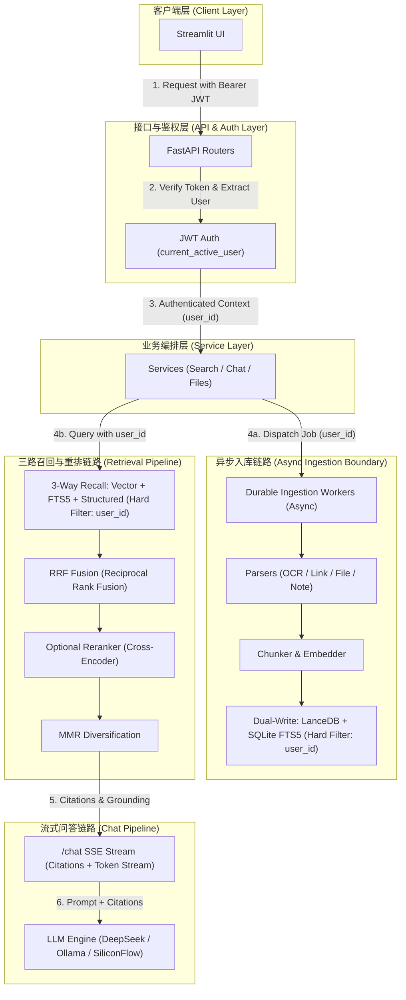

# 架构规范（Architecture）

## 1. 目标形态

自托管知识库：

- **CRUD**：笔记 / 文件 / 链接  
- **异步入库**：解析 → 切块 → embedding → 向量库  
- **检索 + 对话**：后端统一编排，SSE 流式回答并带引用  

## 2. 逻辑分层

```text
HTTP Routers (backend/api/routers/*, auth in router.py)
    → Services (backend/api/services/*)   # 编排，无 HTTP 细节堆砌
        → ORM / SQLAlchemy session       # 元数据
        → Workers (backend/worker/*)     # 长时间任务
        → Parsers (backend/parsers/*)    # 纯解析
        → Vector store (backend/vector_store/*)
```

| 层 | 允许 | 禁止 |
|----|------|------|
| Router | 参数校验、鉴权依赖、状态码、调 service | 大段业务、直接 embed |
| Service | 用例编排、事务边界意识 | 绑死 Streamlit |
| Worker | 入库、重试、调用 parser/vector | 返回 HTTP |
| Parser | 文件→文本+meta | 写库、调 Ollama |
| Vector | 增删查向量 | 用户密码、JWT |

现状：部分 SQL 仍在 router；**新代码优先下沉 service**，旧代码渐进搬迁。

## 3. 双存储

| 存储 | 职责 | 默认实现 |
|------|------|----------|
| 关系库 | 用户、资源元数据、任务、状态 | SQLite（默认目录 `~/.config/wenjv/`，自动回退 `~/.config/inquisitive/`；默认数据库 `wenjv.db`，自动回退 `inquisitive.db`） |
| 向量库 | chunk 向量与检索 meta | LanceDB（可切换 Chroma/Milvus Lite） |

原则：

- **元数据权威在 SQL**；向量是派生物。  
- 更新/删除必须考虑 **两边**（允许最终一致，但要有明确策略）。  
- 向量 meta 必须能过滤租户：`user_id`（及兼容 `belongs_to`）；未来 `workspace_id`。

## 4. 运行时拓扑

```text
Streamlit UI (:8501) --JWT--> FastAPI (:8000)
                                ├─ lifespan: create tables, job workers
                                ├─ Ollama (embed + chat)
                                ├─ SQLite
                                └─ Vector DB files
```

- 入口：`backend/main.py`（`lifespan`，禁止回到全局 `on_event` 启动关键逻辑）。  
- CLI：`wenjv-start-backend` / `wenjv-start-ui` / `wenjv-start` / `wenjv`（产品 formal name 为「wenjv / 问据」；原生支持兼容旧命令 `inquisitive-start*`）。

## 4.1 向后兼容机制 (R2 Backward Compatibility)

系统完整支持以下向下兼容与自动降级机制：

1. **CLI 命令兼容**：
   - 主推荐命令：`wenjv`, `wenjv-start`, `wenjv-start-backend`, `wenjv-start-ui`
   - 历史兼容命令：`inquisitive`, `inquisitive-start`, `inquisitive-start-backend`, `inquisitive-start-ui` 均保持完整支持。
2. **磁盘配置路径回退**：
   - 配置与存储根目录优先使用 `~/.config/wenjv`。
   - 若 `~/.config/wenjv` 不存在且存在历史 `~/.config/inquisitive` 目录，系统自动回退使用 `~/.config/inquisitive`。
3. **数据库文件名回退**：
   - SQLite 数据库文件名优先使用 `wenjv.db`。
   - 若基础目录下 `wenjv.db` 不存在且存在历史 `inquisitive.db` 文件，系统自动回退挂载 `inquisitive.db`。

## 5. 目录约定

| 路径 | 用途 |
|------|------|
| `backend/api/routers/` | 按域拆分路由 |
| `backend/api/services/` | 用例服务 |
| `backend/parsers/` | 可插拔解析器 + registry |
| `backend/worker/` | durable jobs、URL 处理 |
| `backend/vector_store/` | 向量引擎适配 |
| `web/` | Vue 3 SPA（主前端） |
| `tests/` | 自动化测试 |
| `specs/` | 本规范 |
| `eval/` | （规划）评估集，见升级 plan |
| `.hermes/plans/` | 实施计划 |

## 6. 扩展点

- **新文件类型**：`backend/parsers/` 新 Parser + registry + 白名单配置。  
- **新向量后端**：实现与 adapter 相同的 add/search/delete 语义。  
- **新用例**：先 service 方法，再薄 router。

## 7. 非架构（明确不做）

- 不在本阶段引入独立微服务拆分。  
- 不把 Streamlit 当唯一长期架构中心；API 才是稳定边界。  
- 不把 LangChain Agent 作为主干（允许少量胶水：切块/Embedding）。

## 8. 核心链路架构图 (Core Pipeline Topology)



> [!IMPORTANT]
> **权限硬过滤点 (Permission Hard Filtering)**: 所有对元数据库（SQLite）与向量库（LanceDB/Chroma/Milvus）的读写操作，均在数据查询底层强制绑定 `user_id` 与 `belongs_to` 条件，确保绝对的租户数据物理级隔离。
> **异步工作流边界 (Async Worker Boundary)**: 文档与笔记的切块、Embedding 生成及 FTS5 索引构建均由后台 Durable Workers 异步执行，不阻塞主 HTTP 响应请求，支持应用重启后的任务自动断点续跑与失败重试。
