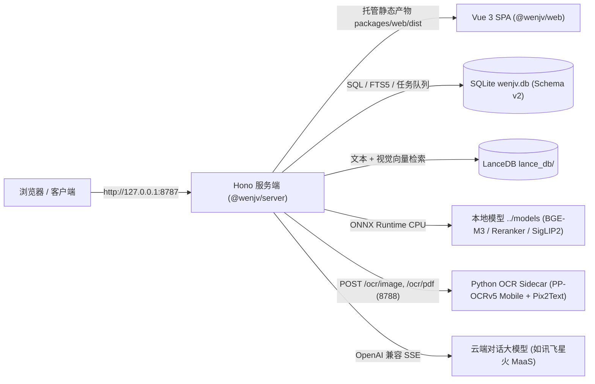

# 问据（Wenjv）TypeScript 架构说明

本文档基于当前 `wenjv-ts/` 源码编写，概述单端口全栈架构、存储层 Schema v2、本地推理与 OCR Sidecar、检索与对话流编排设计。

---

## 一、系统拓扑



---

## 二、工作区目录结构

```text
wenjv-ts/
├── packages/
│   ├── server/                  # @wenjv/server：Hono API + 静态资源托管 + 入库 Worker
│   │   ├── src/
│   │   │   ├── main.ts          # Hono 入口、/health /ping、/api 别名兼容与 SPA fallback
│   │   │   ├── config.ts        # Zod 环境配置（自动读取 $WENJV_BASE_DIR/backend.env）
│   │   │   ├── auth/            # Argon2 / bcryptjs + JWT 鉴权中间件
│   │   │   ├── db/              # Schema v2 建表、FTS5 trigram 虚拟表与 chunks 触发器同步
│   │   │   ├── ai/              # BGE-M3、BGE-Reranker、SigLIP2、OCR 客户端、LLM SSE 解析
│   │   │   ├── parsers/         # txt / md / pdf / docx / pptx / html / 图片等解析器
│   │   │   ├── vector/          # LanceDB 文本向量库与 SigLIP2 视觉向量库
│   │   │   ├── services/        # resources / wiki / search / jobs / assets / tags / reingest
│   │   │   └── routes/          # auth / resources / search / tags / assets / jobs / chat / wiki / admin
│   │   └── test/                # Vitest 集成与单元测试
│   └── web/                     # @wenjv/web：Vue 3 + Pinia + Vite 前端
│       ├── src/
│       │   ├── router/index.ts  # /, /thinking/:id, /library, /wiki/:id?, /admin, /login, /register
│       │   ├── stores/          # auth, chat (含 streamThinking 分离), library, wiki
│       │   ├── views/           # ChatView, ThinkingView, LibraryView, WikiView, AdminView, ShellView
│       │   └── components/      # Icon, StatusDot, ImportModal, FileDrop, wiki/*
├── sidecar/
│   ├── ocr_server.py            # FastAPI 本地 CPU OCR 服务 (PP-OCRv5 Mobile + Pix2Text)
│   ├── test_ocr_server.py       # 真实物理公式图片 + PDF OCR 自动化单测
│   └── pyproject.toml
├── e2e/                         # Playwright 端到端浏览器验收测试
└── scripts/                     # env.sh / doctor.sh / dev.sh / start-prod.sh / verify-all.sh / no-stubs.sh
```

---

## 三、数据模型（Schema v2）

数据库定义位于 `packages/server/src/db/index.ts` 与 `chunks.ts` / `fts5.ts`：

1. **统一资源表 `resources`**：以 `type IN ('file', 'note', 'link')` 统一管理文件、碎片笔记与网页收藏；入库状态流转保存在 `ingestion_jobs`。
2. **结构化知识树 `wiki_pages`**：支持树状层级（`parent_id`、`path` 物化路径、`slug`）、版本历史 `wiki_revisions`、双向链接 `wiki_links` 与别名 `wiki_aliases`。
3. **统一标签与多模态资产**：
   - `tags` + 多态关联表 `entity_tags (entity_type IN ('resource', 'wiki'))`
   - `assets (owner_type IN ('resource', 'wiki', 'chat'))`
   - 笔记「升级为 Wiki」（`POST /resources/:id/promote-to-wiki`）直接复用同一套标签与资产模型，迁移附件与标签并触发 Wiki 侧重新切分索引。
4. **切块与全文索引**：`chunks` 表通过 SQLite 触发器自动同步至 `chunks_fts`（FTS5 `trigram` 分词器）；向量分块保存在 LanceDB 的 `text_vectors` 与 `visual_vectors` 集合。

---

## 四、核心接口总览

所有业务路由同时挂载于根路径及 `/api/*` 前缀下，便于开发代理与单端口生产访问保持一致：

| 模块 | 主要接口 |
| :--- | :--- |
| 健康检查 | `GET /health`、`GET /ping` |
| 认证 | `POST /auth/register`、`POST /auth/jwt/login`、`GET /auth/users/me`、`POST /auth/validate-token` |
| 资源与笔记 | `GET /resources`、`POST /resources/files`、`POST /resources/notes`、`POST /resources/links`、`POST /resources/:id/reingest`、`POST /resources/:id/promote-to-wiki`、`GET/POST /resources/import-legacy` |
| 检索与标签 | `POST /search`、`POST /search/by-image`、`GET/PUT/DELETE /tags` |
| 对话（SSE） | `POST /chat`、`POST /chat/by-image`、`POST /chat/attachments`、`GET /chat/models` |
| Wiki | `GET /wiki/tree`、`CRUD /wiki/pages/:id`、`POST /wiki/pages/:id/move`、`POST /wiki/pages/:id/copilot`、`GET /wiki/graph`、`GET /wiki/search` |
| 系统管理 | `GET /admin/stats`、`GET /admin/logs`、`POST /admin/reset-counts`、`GET /admin` |
| OCR Sidecar (`8788`) | `GET /health`、`POST /ocr/image`、`POST /ocr/pdf` |

---

## 五、对话深度思考分流设计

- `packages/server/src/ai/llm-chat.ts` 提供 `streamChatEvents()`，同时兼容上游模型输出的 `delta.reasoning_content` 字段以及正文中跨分片切分的 `<think>...</think>` 标签。
- `/chat` 与 `/chat/by-image` 分别推送 `{ type: 'thinking', content }` 和 `{ type: 'token', content }` SSE 事件；而 Wiki Copilot 等纯正文生成通道通过 `streamChatCompletions()` 自动过滤思考内容。
- 前端将思考轨迹独立存放在 `ChatMessage.thinking` / `streamThinking`，主气泡保持整洁，点击气泡下方按钮可跳转二级页面 `/thinking/:id` 查看完整推演并与 `<keep-alive>` 保留主对话状态。
